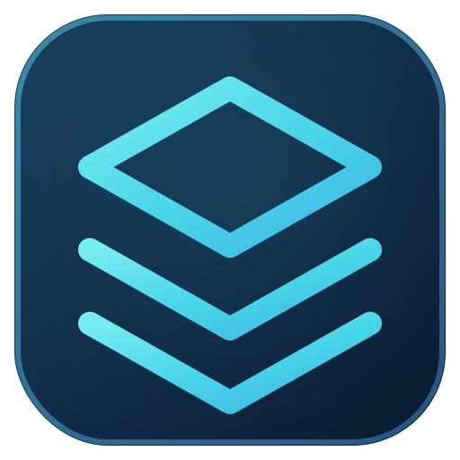
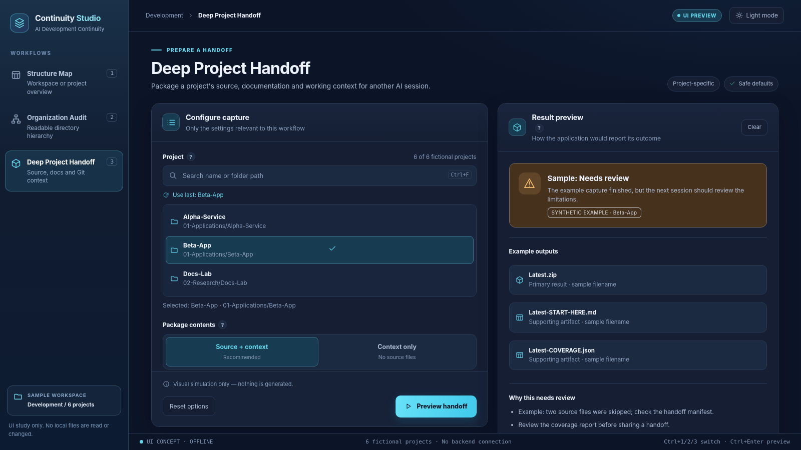
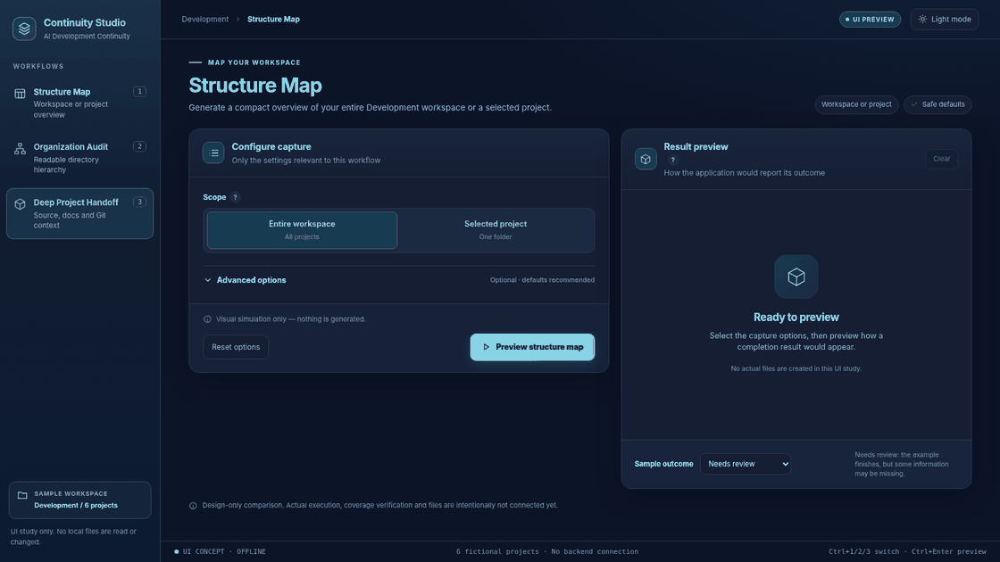

<div align="center">
  

# Continuity Studio

**A streamlined Windows interface for workspace maps and AI development handoffs.**

*Public UI preview · Locally verified Windows beta · Work in progress*
</div>



> **What you're seeing:** This screenshot and the animation below were captured from the **public demo**, using fictional project names and simulated results. They do not depict real outputs or a public production release.

## Three workflows, one interface

| Workflow | Purpose |
| --- | --- |
| **Structure Map** | Orient another session to a whole development workspace or an individual project. |
| **Organization Audit** | Examine a readable folder hierarchy, collapsing technical clutter rather than deleting it. |
| **Deep Project Handoff** | Prepare project source, instructions, Git context, and coverage evidence for continuation. |

The UI includes searchable projects, dark/light themes, contextual settings, delayed plain-English hover help, and differentiated complete / needs-review / unknown / failure states.

### Interactive workflow preview



*Short silent GIF captured from the public HTML demo. No projects are scanned and no files are generated.*

## Two distinct availability levels

**Public GitHub checkout — demo only.** This repository contains the user interface, a restricted Python standard-library host, synthetic tests, and docs. Its `Launch Preview.cmd` uses fictional project data and does **not** bundle or activate the PowerShell backend. It is not a live installer.

**Owner's local Windows Beta — working integration.** The interface has been integrated with the existing **AI Development Continuity v3.1.0-rc9** PowerShell engines. The GUI, host, and relocated engines are installed together in one local `Continuity-Studio` folder; the Development root contains one live launcher. The previous installation was archived for rollback. **The local backend is not included in public Git commits.**

### Try the public demo

On Windows 11, double-click **`Launch Preview.cmd`**. Alternatively open **`GUI/index.html`** in a browser to explore the interface without a host.

The standalone window launcher uses **Python 3.10+** and **Microsoft Edge**. The Python host has no third-party package requirements, and the interface does not fetch remote fonts, scripts, or CDN assets.

To run the synthetic host suite, double-click **`Run Tests.cmd`**. Optional browser tests require separate Playwright tooling. No private workspace or live PowerShell engine is needed.

## Local beta layout (illustrative, not in this public clone)

```text
Development/
├── Continuity Studio.cmd
├── DEVELOPMENT-MAP.md
├── DEVELOPMENT-ORGANIZATION-MAP.md
├── DEVELOPMENT-TREE.txt
├── 00-Shared-Guides/
│   └── AI-Coding-Workflow-Decision-Guide-2026.md
└── 05-Utilities-and-Automation/
    └── Continuity-Studio/
        ├── Backend/             # locally installed; excluded from public Git
        │   ├── Deep/
        │   ├── Organization/
        │   └── Reports/
        ├── GUI/
        ├── Support/
        ├── Tests/
        └── docs/
```

The Structure Map and Organization Audit produce their established Development-root files. Deep Project Handoff writes ZIPs and coverage evidence under the local backend's report directory. Backups, diagnostics, and generated output remain outside public Git commits.

## Validation and known limitations

**Verified locally on Windows (November 18, 2026):**

- **40/40** relocated-host tests and **7/7** disposable real-engine sandbox scenarios passed.
- The live Windows application discovered real projects and generated outputs for all three workflows; the root launcher, engine hashes, and source Git checkpoint were checked during migration.
- Workspace reports correctly flagged an untraversed directory junction/link. Some repositories also lacked accessible Git metadata. **Needs Review** is an intentional coverage warning, not a GUI crash.
- A Deep Project Handoff of Continuity Studio itself produced its three files, but its coverage was **not safe to resume**: locally installed Git-ignored backend source and required README instructions were omitted. That limitation is not concealed by a successful process exit.

Planned improvement: a reviewed, private option to include essential Git-ignored project source without indiscriminately adding logs, caches, backup archives, or credentials.

See [architecture](docs/ARCHITECTURE.md) and [roadmap](docs/ROADMAP.md) for the implementation boundaries and next steps.

## License and sharing

This project is currently **publicly viewable but not licensed as open source**. There is no open-source license grant; ordinary copyright protections apply. We may evaluate a license after the first public-release review.

Copyright © 2026 HyunCafe. All rights reserved at this stage.
